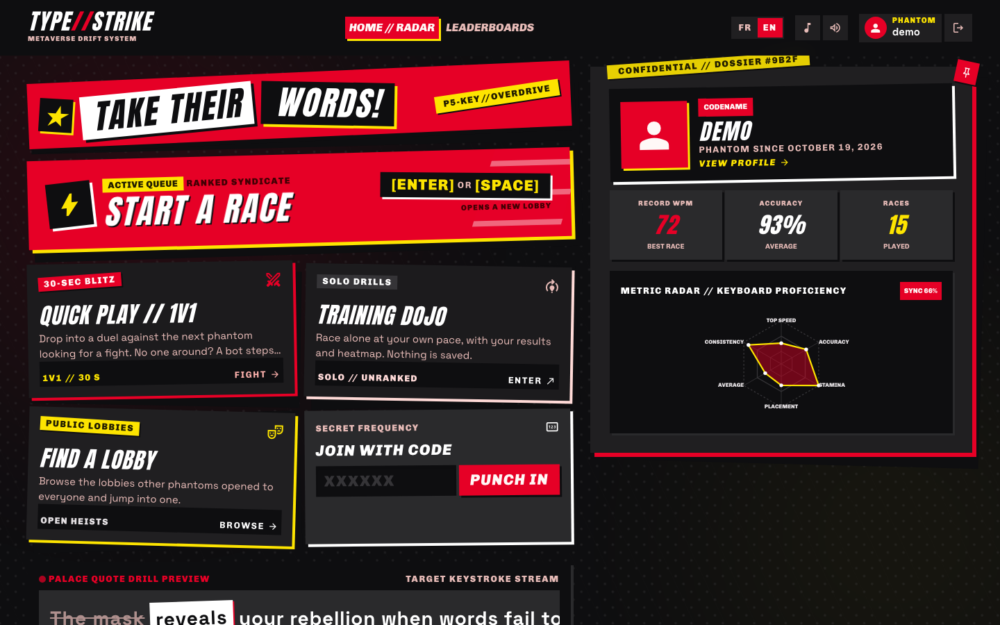
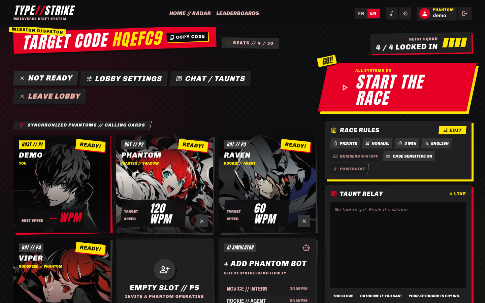
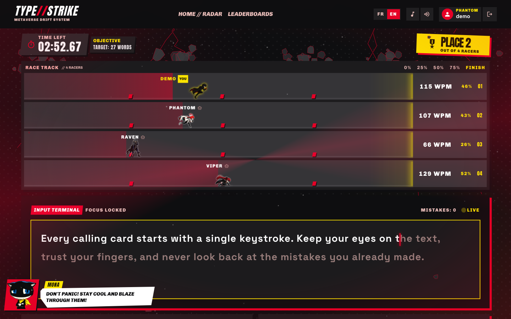
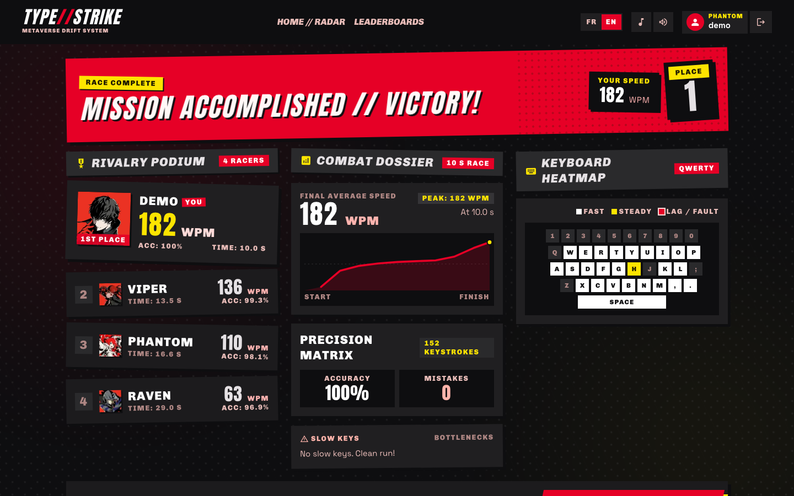
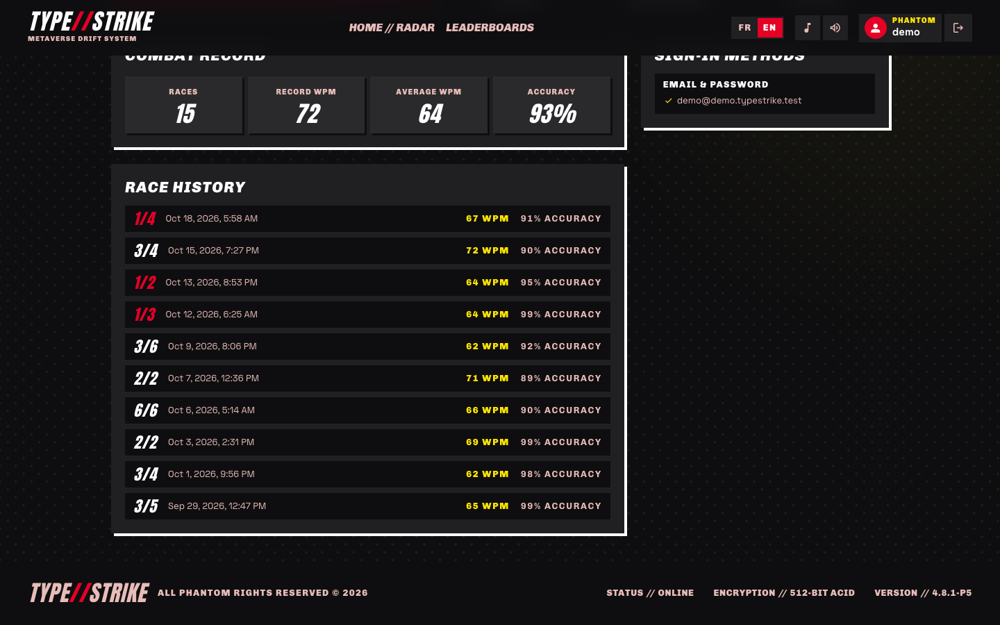
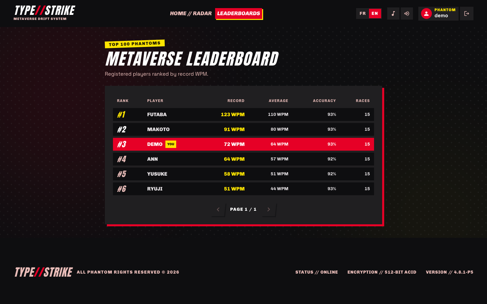

# TYPE//STRIKE

A competitive, real-time typing race for students, inspired by Monkeytype and Kahoot, with a Persona 5 look. Players type the same text and race each other live: positions, speed and accuracy update as they type, and every race ends on a podium with detailed stats.

School project (Cégep, 3rd year, web programming).

**Production:** https://typestrike.up.railway.app/fr

### Demo account

| Email | Password |
| --- | --- |
| `demo@demo.typestrike.test` | `typestrike-demo` |

Created by `npm run db:seed`. It starts with no races: its stats, history and leaderboard spot appear once you play. Sign in at `/fr/sign-in` or `/en/sign-in`.

## Screenshots

| | |
| --- | --- |
|  |  |
| Home: start a race, quick 1v1, dojo, join by code, player dossier and skill radar | Lobby: host, bots of different levels, ready-up, race rules and chat |
|  |  |
| Race: live track with every racer's position and WPM, typing terminal | Results: podium, speed over time, accuracy, keyboard heatmap |
|  |  |
| Profile: personal stats and race history | Leaderboard: top registered players |

## Features

- **Real-time multiplayer races**: lobbies with a 3 s synchronized countdown, live track with animated runners, live places, results page (podium, speed chart, accuracy, keyboard heatmap).
- **Lobbies**: private (join with a 6-character code or link) or public (listed in the lobby browser); ready-up, host-only start, chat and quick taunts.
- **Race settings** (host only): normal or sudden death (first mistake eliminates you), time limit (30 s to 3 min, or none), texts with numbers, case sensitivity.
- **Game modes**: quick 1v1 matchmaking (a bot steps in after 15 s), solo training dojo (not saved).
- **Bots** with four levels (about 30, 60, 120 and 150 WPM), human-like rhythm and typos.
- **Accounts**: email/password, plus Google, GitHub and Discord sign-in; 12 playable characters.
- **Stats**: race history, skill radar on the home page, top 100 leaderboard.
- French and English UI.

The server is authoritative: clients only send keystrokes; progress, places, results and saved stats are computed on the server.

## Stack

Next.js (App Router) · React · TypeScript (strict) · Tailwind CSS · PostgreSQL (Drizzle ORM) · Vitest · Playwright · GitHub Actions.

Real-time updates use Server-Sent Events from Next.js route handlers (no separate socket server). Lobbies and races live in the memory of the Node process, so the app must run as a **single long-running instance** (`next start`), not on serverless hosting.

## Getting started

Requirements: Node.js 22.18+ (scripts in `scripts/` run TypeScript directly) and PostgreSQL (17 is used in CI).

1. Install dependencies: `npm ci`
2. Start a database: `docker compose up -d` (or use any local PostgreSQL).
3. Copy `.env.example` to `.env` and set `DATABASE_URL` (the default matches `docker-compose.yml`). OAuth providers are optional: a sign-in button appears only when its client id and secret are set.
4. Create the tables: `npm run db:migrate`
5. Add demo data (texts and the demo account): `npm run db:seed`. Safe to run again. Add `-- --rivals` for five extra accounts with a race history, so the local leaderboard and stats are not empty.
6. Start the app: `npm run dev`, then open http://localhost:3000 (redirects to `/fr`; English is at `/en`).

To play from other devices on the same network during development, see `ALLOWED_DEV_ORIGINS` in `.env.example`.

### Environment variables

All are documented in [`.env.example`](.env.example). Never commit `.env`.

| Variable | Required | Purpose |
| --- | --- | --- |
| `DATABASE_URL` | yes | PostgreSQL connection string |
| `APP_URL` | in production | Public base URL, used to build OAuth callback URLs |
| `GOOGLE_CLIENT_ID` / `GOOGLE_CLIENT_SECRET` | no | Google sign-in (button hidden when unset) |
| `GITHUB_CLIENT_ID` / `GITHUB_CLIENT_SECRET` | no | GitHub sign-in |
| `DISCORD_CLIENT_ID` / `DISCORD_CLIENT_SECRET` | no | Discord sign-in |
| `LOBBY_CAPACITY` | no | Maximum players per lobby (default 30, capped at 60) |
| `ALLOWED_DEV_ORIGINS` | no | Extra hosts allowed to reach the dev server (LAN play) |

## Checks

| Command | What it does |
| --- | --- |
| `npm run lint` | ESLint |
| `npm run typecheck` | Route types, then strict TypeScript |
| `npm test` | Unit tests (Vitest) |
| `npm run build` | Production build |
| `npm run test:e2e` | End-to-end tests (Playwright; run `npx playwright install chromium` once). Needs a migrated database; test accounts are deleted after each run. |

CI runs all of them on every push and pull request.

## Deployment

The app needs a long-running Node server (one instance) and PostgreSQL. Both configs below build with `npm run build`, apply migrations, start with `next start` (it listens on the platform's `PORT`) and check `/fr`.

### Railway (`railway.json`)

1. Create a project from the GitHub repo; Railway reads `railway.json`.
2. Add a **PostgreSQL** database to the project.
3. In the app service variables, set `DATABASE_URL` to the database's URL (reference variable `${{Postgres.DATABASE_URL}}`) and `APP_URL` to the public URL (`https://…`).
4. Generate a public domain (Settings → Networking). Keep **one replica**.

Migrations run when the app starts (the start command is `npm run db:migrate && npm run start`).
To create the demo account in production, run `npm run db:seed` once with the production `DATABASE_URL` (for example `railway run npm run db:seed`). It only adds the race texts and the seed accounts.

### Render (`render.yaml`)

1. New → **Blueprint**, pick the repo; Render creates the web service and the database from `render.yaml`.
2. When asked, set `APP_URL` to the service URL (`https://<name>.onrender.com`).

Migrations run at startup. On the free plan the service sleeps when idle (the first visit takes a while and open lobbies are lost) and the free database expires after a while; a paid instance avoids both.

### After deploying

- HTTPS is required: the session cookie is `Secure` in production (both platforms provide HTTPS).
- OAuth is optional. To enable a provider, set its `*_CLIENT_ID` / `*_CLIENT_SECRET` and register `{APP_URL}/api/auth/{google|github|discord}/callback` in its app.
- Every redeploy or restart ends the lobbies in progress; accounts and stats stay in PostgreSQL.

## Documentation

Detailed docs are in [`docs/`](docs/README.md): architecture and multiplayer design, design system, translations, testing, and the current status of each feature.

## Third-party content notice

This is a non-commercial school project made for a class at Cégep. It is not affiliated with, endorsed by or sponsored by ATLUS or SEGA.

Persona and Persona 5, their characters, artwork, music, sound effects and voice clips are trademarks and copyrighted works of ATLUS / SEGA. The character portraits (`public/portraits/`), sprite sheets (`public/sprites/`, fan art based on those characters), music (`public/music/`), sound effects (`public/sfx/`) and voice clips (`public/voices/`) are used for educational purposes only and remain the property of their respective owners. They must be replaced with original or licensed assets before any commercial or public release of the game.

All other code in this repository was written for this project.
